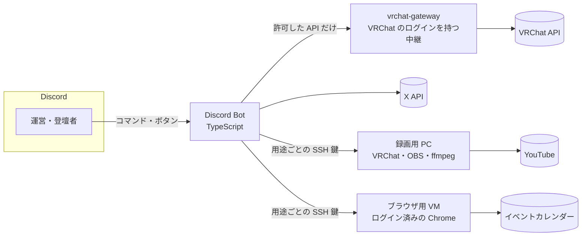

# Engineer Meetup Discord Bot

技術コミュニティ「[エンジニア集会](https://engineer-meetup.com/)」の運営を自動化する Discord Bot です。
エンジニア集会は、2021 年から VRChat で毎週金曜日に開いている、ジャンルを問わないエンジニアの集まりです。

毎週の開催確認から、SNS での告知、VRChat のインスタンス作成、LT（ライトニングトーク）の応募受付と録画の公開まで、
運営が手で回していた作業を Discord のコマンドとボタンにまとめています。運営の誰かが忙しくなっても、集会が止まらないようにするためです。

## できること

| 機能 | 内容 |
| :--- | :--- |
| 開催確認 | 毎週月曜に「今週やる？」を運営に聞き、YES なら VRChat・Discord・外部のイベントカレンダーに登録する |
| 告知 | 前日に X へ事前告知、当日に X・Discord・VRChat グループへ開催告知を投稿する |
| インスタンス作成 | VRChat のグループインスタンスを作り、運営とサブアカウントを招待する |
| LT 応募 | 応募を Discord のフォーラムで受け付け、日程調整・素材の回収・告知画像の生成・告知までを 1 本の流れで扱う |
| LT 録画 | 録画用 PC の VRChat と OBS を操作して LT を録画し、LT ごとに編集して YouTube にアップロードする |
| 活動の集計 | Discord サーバーの発言・リアクション・VC を日ごとに集計する（本文は保存しない） |

機能ごとの詳しい説明は [docs/features.md](docs/features.md) にあります。

## 全体の構成



## 設計で工夫したこと

- **機能ごとのフォルダー**: `src/discordbot/features/<機能>/` に機能をまとめ、外に見せるものは `index.ts` だけにしています。
  機能が増えて全体を把握しにくくなったため、少しずつ PR を分けて移しました（[docs/ARCHITECTURE.md](docs/ARCHITECTURE.md)）。
- **import の決まりをテストで守る**: [dependency-cruiser](https://github.com/sverweij/dependency-cruiser) で「機能は他の機能の内部を直接 import しない」などの決まりを書き、`npm test` で検査しています。違反は 0 件です。
- **秘密をゲートウェイに集める**: VRChat のパスワードと 2FA の秘密鍵は vrchat-gateway だけが持ち、Bot には許した API を呼べるトークンしか渡していません（[docs/vrchat.md](docs/vrchat.md)）。
- **1 つの鍵で 1 つのことしかできない SSH**: 録画用 PC とブラウザ用 VM には、`command=` で実行できるスクリプトを 1 つに固定した鍵で入ります。Bot が乗っ取られても、その PC で好きなコマンドは打てません（[recorder-pc/](recorder-pc/README.md)、[browser-desktop/](browser-desktop/README.md)）。
- **本番とテストの分離**: テスト用チャンネルから操作すると、投稿や登録は送らずに内容だけを返すか、テスト用のグループに作ります。
- **告知画像は HTML と CSS で描く**: ヘッドレス Chromium で PNG にしています。描画中は外部への通信をすべて遮断しています。

## 使っている技術

- **Bot**: TypeScript、discord.js、node-cron、twitter-api-v2、Vitest、dependency-cruiser
- **告知画像**: React（テンプレート）、puppeteer-core と Chromium
- **録画用 PC**: PowerShell、Python、OBS、ffmpeg、VRChat の OSC
- **ブラウザ用 VM**: Python、Playwright
- **動かしている場所**: Proxmox VE 上の LXC（systemd）。main にマージすると自動でデプロイされます

## 動かし方

```bash
npm install
cp .env.example .env   # 値を埋める
npm start              # ts-node で起動する
```

環境変数・本番のセットアップ・状態ファイル・テストは [docs/operations.md](docs/operations.md) にあります。

## ドキュメント

| ページ | 内容 |
| :--- | :--- |
| [docs/features.md](docs/features.md) | 機能ごとの詳しい説明 |
| [docs/commands.md](docs/commands.md) | スラッシュコマンドの一覧 |
| [docs/lt-workflow.md](docs/lt-workflow.md) | LT の応募から告知までの流れ |
| [docs/vrchat.md](docs/vrchat.md) | VRChat アカウントの登録・招待・ログイン |
| [docs/operations.md](docs/operations.md) | セットアップ・本番の運用・状態ファイル・テスト・告知画像のテンプレート |
| [docs/ARCHITECTURE.md](docs/ARCHITECTURE.md) | 実装の地図・ディレクトリ構造・import の決まり |
| [docs/dependency-graph.md](docs/dependency-graph.md) | 依存関係の図 |
